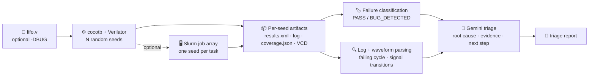

<h1 align="center">🤖 AI-Assisted RTL Regression and Debug Automation Framework</h1>

<p align="center">
  <b>Randomized cocotb regression &nbsp;•&nbsp; Fault injection &nbsp;•&nbsp; Waveform and log analysis &nbsp;•&nbsp; Gemini-powered root-cause triage</b>
</p>

<p align="center">
  
  
  
  
  
  
  
  
</p>

<p align="center">
  
  
  
</p>

---

## 📌 Table of Contents

1. [Overview](#-overview)
2. [Key Results](#-key-results)
3. [Pipeline Architecture](#-pipeline-architecture)
4. [The Design Under Test and the Injected Bug](#-the-design-under-test-and-the-injected-bug)
5. [Waveform Evidence](#-waveform-evidence)
6. [Stimulus Coverage Counters](#-stimulus-coverage-counters)
7. [AI-Assisted Triage](#-ai-assisted-triage)
8. [Tech Stack](#-tech-stack)
9. [Repository Structure](#-repository-structure)
10. [Getting Started](#-getting-started)
11. [Slurm Job-Array Mode](#-slurm-job-array-mode)
12. [Engineering Decisions and Bugs Fixed Along the Way](#-engineering-decisions-and-bugs-fixed-along-the-way)
13. [Limitations](#-limitations)
14. [Future Work](#-future-work)
15. [Author](#-author)

---

## 🎯 Overview

Debugging a failing regression is slow: engineers open logs, hunt for the first error, then open waveforms. This project automates that loop for a Verilog design.

It runs a **cocotb** testbench over many **random seeds**, decides pass or fail from the XML results, extracts the failing cycle and signal transitions from logs and VCD waveforms, and asks an **LLM (Gemini)** to group the failures by root cause and suggest a next debug step. The whole flow runs from one command, locally or as a **Slurm job array**.

The demo design is a synchronous **FIFO** (depth 8) with a compile-time switch that injects a realistic bug, so the tool has genuine failures to triage.

---

## 📊 Key Results

| 🧪 Metric | ✅ Clean RTL | 🐞 Bug-injected RTL |
|---|:---:|:---:|
| Randomized seeds (Slurm, single node) | **20** | **20** |
| Passed | **20** | **0** |
| Failed | **0** | **20** |
| Classification | **20 × PASS** | **20 × BUG_DETECTED** |
| Total regression runs | **40** | |

> ℹ️ These numbers describe this FIFO and this one injected bug. They are **not** a general bug-detection rate.

**Smaller local run (8 seeds) showing why the clean result is meaningful:**

| Metric | Clean RTL | Bug-injected RTL |
|---|:---:|:---:|
| Result | 8/8 passed | 0/8 passed |
| Simulated cycles | 16,000 | 312 (each seed stops at its first failure) |
| Cycles with FIFO full | 5,166 | 10 |
| Writes attempted while full | 3,112 | 8 |

The clean design survived thousands of write-while-full attempts, and the buggy design failed on the first one in every seed.

---

## 🏗️ Pipeline Architecture



---

## 🔌 The Design Under Test and the Injected Bug

A synchronous FIFO, 8 bits wide and 8 entries deep (`rtl/fifo.v`).

```verilog
`ifdef BUG
  wire do_wr = wr_en;            // 🐞 bug: ignores full
`else
  wire do_wr = wr_en && !full;   // ✅ correct
`endif
```

Compile with `-DBUG` (via `BUG=1` in the Makefile) to switch the fault on.

**The same root cause shows up as two different symptoms:**

| # | Scenario while the FIFO is full | What the DUT does | What the model expects |
|---|---|---|---|
| 1️⃣ | Write with no read | Accepts the write, `count` goes **8 → 9**, `full` drops to 0 | `full = 1` |
| 2️⃣ | Write and read in the same cycle | Accepts both, `count` stays 8, so `full` stays 1 | occupancy 7, `full = 0` |

The testbench scoreboard rejects a write into a full FIFO, so the two models diverge at the first such cycle.

---

## 🌊 Waveform Evidence

From the seed 1 VCD of the bug-injected run:

| Time | Event |
|---|---|
| 265 ns | `wr_en` rises and `do_wr` follows it directly (no gating) |
| 270 ns | `count` reaches 8 and `full` goes high (a legal write) |
| 280 ns | A further write is accepted: `count` goes **8 → 9**, `wp` advances, and `full` **drops to 0** |
| 281 ns | The testbench assertion fires: `actual=0, expected=1, occupancy=8` |

A waveform parser (`triage/parse_waveform.py`) extracts the signal transitions near the failure time for every seed, so the LLM receives evidence from the waveform and not just the error text.

> 🖼️ Add your GTKWave screenshot here: `docs/fifo_bug_waveform.png`

---

## 📈 Stimulus Coverage Counters

Each seed writes a `coverage.json` (even when it fails) counting which scenarios the random traffic reached:

| Counter | Meaning |
|---|---|
| `full_cycles` / `empty_cycles` | Cycles spent full or empty |
| `writes_blocked_full` | Writes attempted while full |
| `reads_blocked_empty` | Reads attempted while empty |
| `simultaneous_requests` | Read and write requested together |
| `accepted_writes` / `accepted_reads` | Operations the model accepted |
| `max_occupancy` | Highest FIFO occupancy reached |

> These are simple stimulus counters, not SystemVerilog covergroups. They tell you whether the stimulus could expose a bug, such as `writes_blocked_full > 0` for this one.

---

## 🧠 AI-Assisted Triage

`triage/triage_llm.py` sends Gemini the RTL and a compact record per failing seed (assertion text, first failing cycle, simulation time, waveform transitions). It asks for JSON that groups failures by root cause.

What the report contained for this project:

- ✅ Correctly identified `do_wr` ignoring `full` as the root cause
- ✅ Described both symptoms (write while full, and simultaneous read/write while full)
- ✅ Cited waveform evidence such as `count` going 8 → 9 and `full` dropping
- ✅ Suggested the fix `wire do_wr = wr_en && !full;`, which is the clean-RTL branch

**Quality guard:** after the model replies, the script checks that every failing seed appears in the report and appends a warning if any are missing.

---

## 🛠️ Tech Stack

| Area | Tools |
|---|---|
| 🔧 **HDL** |  |
| 🧪 **Verification** |   |
| 🐍 **Scripting** |    |
| 🤖 **AI / LLM** |  |
| 🖥️ **Compute** |  -FCC624?style=flat-square&logo=linux&logoColor=black) |
| 🌊 **Debug** |  |
| 🗂️ **Version control** |   |

---

## 📁 Repository Structure

```text
.
├── 📄 README.md
├── 📄 requirements.txt
├── 📄 .gitignore
├── 🔌 rtl/
│   └── fifo.v                  # FIFO with -DBUG fault injection
├── 🧪 tests/
│   ├── test_fifo.py            # cocotb testbench: seeded RNG, scoreboard, coverage counters
│   └── Makefile                # Verilator build, BUG=1 switch
├── 🤖 triage/
│   ├── run_pipeline.py         # one-command pipeline driver
│   ├── run_regression.py       # parallel multi-seed runner (timeout, XML pass/fail)
│   ├── run_one.py              # single-seed entry point for Slurm tasks
│   ├── collect.py              # merges per-seed results into summary.json
│   ├── classify_results.py     # PASS / BUG_DETECTED classification
│   ├── parse_logs.py           # failing assertion, cycle, sim time
│   ├── parse_waveform.py       # VCD transitions near the failure
│   ├── coverage_report.py      # stimulus-coverage aggregation
│   └── triage_llm.py           # Gemini root-cause grouping
├── 🖥️ slurm/
│   ├── regression.sbatch       # job array, one seed per task
│   └── validate_pipeline.sbatch
├── 🖼️ docs/                    # waveform screenshots
└── 📊 results/                 # curated clean and bug-injected evidence
```

---

## 🚀 Getting Started

**Requirements:** Linux or WSL2, Python 3.12, Verilator (5.020 tested), `make`. Slurm is optional.

```bash
# 1️⃣ Clone
git clone https://github.com/GithubJayanta/ai-rtl-regression-debug-framework.git
cd ai-rtl-regression-debug-framework

# 2️⃣ Environment
python3 -m venv .venv && source .venv/bin/activate
pip install -r requirements.txt

# 3️⃣ API key for LLM triage (never commit it)
export GEMINI_API_KEY="your_key_here"

# 4️⃣ Run
python triage/run_pipeline.py 8            # clean regression, 8 seeds
python triage/run_pipeline.py 8 --bug      # bug injected, plus LLM triage
```

Outputs land in `runs/` (git-ignored): per-seed logs, `results.xml`, `coverage.json`, waveforms, `summary.json`, `classification_report.json`, and `triage_report.md`.

---

## 🖥️ Slurm Job-Array Mode

Each array task runs one seed in its own directory, so tasks never collide.

```bash
sbatch slurm/regression.sbatch          # submit the job array
squeue                                  # watch running (R) and pending (PD) tasks
# wait until the queue is empty, then:
python triage/collect.py                # merge per-seed results
python triage/triage_llm.py             # LLM triage
```

> ⚠️ Tested on a **single-node** Slurm installation on WSL2. It has not been run on a multi-node cluster, and it gives no speedup over the local threaded runner on a 4-core laptop. Its purpose is to show the same per-seed entry point scaling to a scheduler.

---

## 🧩 Engineering Decisions and Bugs Fixed Along the Way

| 🔎 Problem found | 🛠️ Fix |
|---|---|
| cocotb's `make` exits with code 0 even when a test fails | Pass/fail is read from `results.xml`, not the exit code |
| A stale build directory ran the **buggy** binary for a **clean** run | One build directory per seed **and** per mode (`build_bug0` / `build_bug1`) |
| Oversized LLM prompts **silently dropped seeds** from the report | Send compact structured fields only, and verify every failing seed appears in the output |
| Failing seeds wrote no coverage because the test aborted early | Coverage is written in a `try/finally` block |
| A hung simulation could block the whole regression | 120-second per-run timeout |
| Old output files could look like fresh results | Results and coverage files are deleted before each run |
| An empty Slurm collect printed "all passed" | The collector refuses to proceed when no result files exist |

---

## ⚠️ Limitations

- Single design (a FIFO) and a single testbench.
- The LLM sees the injected bug in the RTL source, so this is **triage of a known fault**, not discovery of an unknown one.
- Coverage is stimulus counting, with no cross-coverage or coverage closure.
- Slurm was tested on one node only.
- The tool does not automatically verify that a suggested fix works. The clean-RTL branch is the known fix and passes 20/20.

---

## 🔭 Future Work

- ➕ A second design and bug class, such as a UART or an arbiter
- 🔁 A fix-verification loop that applies the suggested patch and re-runs the regression
- ⚡ Compile the simulator once per mode and reuse it across seeds
- 🧬 LLM-generated testbench drafts with an automatic repair loop
- 🗄️ NFS-shared results directory for multi-machine runs
- 🔄 CI workflow that runs the clean regression on every push

---

## 👤 Author

<p align="center">
  <b>Jayanta Chakraborty</b><br/>
  B.Tech, Electronics and Communication Engineering · Jalpaiguri Government Engineering College<br/><br/>
  <a href="https://github.com/GithubJayanta"></a>
  <a href="https://www.linkedin.com/in/jayanta-chakraborty-6625aa28a/"></a>
</p>

<p align="center">⭐ If you find this useful, consider starring the repository.</p>
